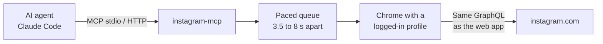

<div align="center">

# instagram-mcp

An MCP server that lets AI agents use an Instagram account through a real, logged-in Chrome browser.<br>
No browser extension, no paid subscription, and it runs on a server with Docker.


[Quick start](#quick-start) · [Tools](#tools) · [How it works](#how-it-works) · [Staying safe](#staying-safe) · [Contributing](#contributing)

</div>

## What is this?

`instagram-mcp` gives an AI agent such as Claude Code access to one Instagram account. The agent can read profiles and posts, reply to DMs, comment, like and follow, analyze followers, and find potential customers and keep them in a lead list.

Once the agent is connected, you can ask it things like:

> Find coffee shops in Brooklyn that still take orders over WhatsApp, score them, and show me the top-priority ones.

The agent then calls `lead_discover`, `lead_enrich`, and `lead_list` on its own.

## Why not the official Instagram API?

The official Instagram Graph API only works for business accounts linked to a Facebook Page. It can't freely read other people's profiles or search for leads, and DM access requires Meta's app review.

`instagram-mcp` works the way you do in a browser. Every request is sent from an instagram.com page that is already logged in, so you get the same data you would see on the web.

## Quick start

You need Node.js 20 or newer and Google Chrome.

```sh
git clone https://github.com/wirnat/instagram-mcp.git
cd instagram-mcp
npm install
npm run build
node dist/index.js login
```

`login` opens a Chrome window. Log in to Instagram there. The window closes by itself once you are logged in, and the server never reads your password.

Start the server and connect Claude Code:

```sh
node dist/index.js serve --http
claude mcp add --transport http instagram http://127.0.0.1:48300/mcp
```

To check the connection, ask the agent "Which Instagram account is logged in?". It will call `account_info`.

> [!NOTE]
> Only one process can use the Chrome profile at a time. Run a single server in HTTP mode and point all your agents at that address.

<details>
<summary>Other CLI commands</summary>

```
login                 Open a Chrome window to log in to Instagram (once per machine)
serve [--http]        Run the MCP server. stdio by default; --http serves http://127.0.0.1:48300/mcp
status                Check whether the Instagram session is still logged in
tools                 List the tools
call <tool> [json]    Call one tool (through the HTTP server if one is running)
probe <url> [ms]      Open an Instagram page and record the GraphQL queries it loads
```

</details>

## Running on a server with Docker

The base image is 3.6 GB, so check your free disk space first.

```sh
df -h
echo "INSTAGRAM_MCP_TOKEN=$(openssl rand -hex 24)" > .env
docker compose build
```

Log in once through noVNC, which shows the container's Chromium window in your browser:

```sh
docker compose run --rm -p 127.0.0.1:6080:6080 instagram-mcp login
```

From your laptop, open an SSH tunnel to port 6080 on the server, go to `http://localhost:6080/vnc.html`, and log in to Instagram there. The container stops once the login succeeds.

```sh
docker compose up -d
```

The server listens on `127.0.0.1:48300` on the host. Agents connect with the header `Authorization: Bearer <INSTAGRAM_MCP_TOKEN>`. If your agents run on another machine, put a TLS reverse proxy in front of it.

### Several accounts on one host

One container controls one account. Give each account its own project name, `.env` file, and host port, so containers and data volumes stay separate:

```sh
# west.env
INSTAGRAM_MCP_TOKEN=...
HOST_PORT=48301
TZ=Asia/Jakarta
```

```sh
docker compose -p ig-west --env-file west.env run --rm -p 127.0.0.1:6080:6080 instagram-mcp login
docker compose -p ig-west --env-file west.env up -d
```

Log in to one account at a time, since every login uses port 6080 for noVNC.

Two settings help when several agents share a host:

- `INSTAGRAM_MCP_READ_ONLY=1` on the server turns an account into a research account. Tools that change the account (DMs, likes, follows, comments, posts, profile edits) are hidden and refused, while reading, searching, and follower scans still work.
- `INSTAGRAM_MCP_REMOTE=1` on the agent's side makes `instagram-mcp call` and `status` talk only to the running server at `INSTAGRAM_MCP_PORT` with `INSTAGRAM_MCP_TOKEN`. If the server is down, the command fails instead of starting a local browser. Giving each agent only its own account's port and token keeps agents from using each other's accounts.

## Tools

There are 67 tools. ✅ means the tool was tested against real Instagram on November 14, 2026 with a test account. 🧪 means the code exists but hasn't been tested yet, so don't rely on it.

| Group | Tools |
|---|---|
| Account and reading | ✅ `account_info` `ig_fetch_profile` `ig_fetch_posts` `ig_fetch_post` `ig_search` `ig_hashtag_posts` `ig_fetch_stories` `ig_fetch_saved` `ig_fetch_tagged` `location_search` |
| DMs | ✅ `dm_list` `dm_read` `dm_send` `dm_requests` `dm_mark_seen` |
| Comments | ✅ `comments_list` `comment_add` `comment_reply` `comment_like` `comment_delete` |
| Actions | ✅ `ig_action` (like, unlike, follow, unfollow) `ig_block` (block only) · 🧪 `follower_remove` |
| Notifications | ✅ `notifications_list` `follow_requests_list` `events_check` |
| Followers | ✅ `peers_scan` `peers_report` `peers_export` `antibot_scan` `antibot_report` · 🧪 `unfollowers_scan` `unfollowers_report` `story_viewers` |
| Insights and downloads | ✅ `insights_collect` `insights_report` `downloads_start` `downloads_status` |
| Leads | ✅ `lead_discover` `lead_from_location` `lead_from_followers` `lead_from_engagers` `lead_similar` `lead_enrich` `link_inspect` `lead_list` `lead_update` `lead_export` `lead_config` |
| Publishing | ✅ `draft_create` `draft_list` and the other draft tools (local storage only) · 🧪 `draft_publish` `ig_post_edit` `ig_post_delete` |
| Profile | 🧪 `profile_update` `note_set` |
| Jobs | ✅ `jobs_status` |

Run `node dist/index.js tools` for the full list with parameters.

### Finding leads

1. Call `lead_discover` with a keyword and a city, for example "coffee shop" and "Brooklyn". Candidates are saved as unscored.
2. Call `lead_enrich` with `pending` to fetch each profile and give it priority A, B, or C. Add `deep` to also open the links in the bio, and `activity` to check whether the account still posts.
3. Use `lead_list` to pick who to contact. Sending a DM with `dm_send` moves the lead's status to `contacted`.

Out of the box the scoring is generic: it looks at follower count, contact details, and booking links. You can teach it what your ideal customer looks like with `lead_config`, which takes business types, cities, competitor booking apps, and a default phone country code. [`examples/lead-config.salon-id.json`](examples/lead-config.salon-id.json) is a full example for salons and barbershops in Indonesia, and you can load it with `lead_config` and `preset: "salon-id"`.

## How it works



The server runs Chrome with its own profile in `~/.instagram-mcp/profile`. Every request is sent from inside an instagram.com page, with that browser's cookies and headers.

Instagram's web app gets almost all of its data through GraphQL, and the server calls the same queries. Query IDs (`doc_id`) are not hard-coded. The server reads them from the JavaScript that Instagram loads, so they stay current when Instagram ships a new version.

Some queries are only loaded on specific pages, such as the DM inbox. For those, the server opens the page once, records the request the web app sends, and caches it in `~/.instagram-mcp/data/gql-learned.json`.

## Staying safe

> [!WARNING]
> Automating an account breaks Instagram's terms of use, and the account can be restricted or banned. Keep the volume low, and test with an account you can afford to lose.

The server already limits itself:

- All requests go through one queue with a random 3.5 to 8 second gap.
- Default daily limits are 15 DMs to new people, 150 likes, 60 follows, and 60 comments.
- If Instagram asks for verification or blocks an action, the server stops sending actions for a few hours.
- If the session gets logged out, the server stops sending requests until you log in again.

Two more rules come from things that went wrong during testing:

1. **Don't run many searches back to back.** About six searches within a few minutes got a "Try Again Later" response. Leave a few minutes between batches.
2. **Never call an endpoint the web app doesn't use.** A single request to a guessed API path got the session logged out. Use `probe` to see what the web app sends and copy it exactly.

## Configuration

| Variable | Default | Meaning |
|---|---|---|
| `INSTAGRAM_MCP_HOME` | `~/.instagram-mcp` | Folder for the Chrome profile, data, and downloads |
| `INSTAGRAM_MCP_PORT` | `48300` | HTTP port |
| `INSTAGRAM_MCP_HOST` | `127.0.0.1` | Address to listen on |
| `INSTAGRAM_MCP_TOKEN` | empty | Bearer token, required when the host is not 127.0.0.1 |
| `INSTAGRAM_MCP_READ_ONLY` | `false` | Refuse every tool that changes the account |
| `INSTAGRAM_MCP_REMOTE` | `false` | `call` and `status` only talk to a running server |
| `INSTAGRAM_MCP_HEADLESS` | `false` | Run Chrome without a window |
| `INSTAGRAM_MCP_CHROME_CHANNEL` | `chrome` | Leave empty to use Playwright's bundled Chromium |
| `INSTAGRAM_MCP_MIN_GAP_MS`, `INSTAGRAM_MCP_MAX_GAP_MS` | `3500`, `8000` | Gap between requests |
| `INSTAGRAM_MCP_LIMIT_COLD_DM`, `_LIKE`, `_FOLLOW`, `_COMMENT` | `15`, `150`, `60`, `60` | Daily limits |

## Not supported yet

- Accepting or declining message requests.
- Unblocking an account. Use the Instagram app for now.
- Music, story stickers, and links in stories.
- Account search returns about 5 results per keyword, which is a limit of Instagram's web search. For more, use `ig_hashtag_posts` or `lead_discover`.

## Contributing

The most useful contributions right now are testing the 🧪 tools and adding tools for the features above. Read [Staying safe](#staying-safe) first, and use a test account, not a business account.

### Setup

```sh
npm install
npm test                                    # build and unit tests
node scripts/smoke.mjs                      # MCP over stdio, without touching Instagram
node scripts/smoke-http.mjs <url> <token>   # HTTP mode and bearer token
```

### Adding a tool

Each tool is registered with `defineTool` in one of the files in `src/tools/`:

```ts
defineTool({
  name: 'dm_mark_seen',
  description: 'Mark a DM thread as seen up to its latest incoming message.',
  params: [{ name: 'thread_id', type: 'string', description: 'Thread id from dm_list.', required: true }],
  risk: 'write', // read, write, or action
  handler: async ({ thread_id }, ig) => {
    // call ig.gql(...) with the same query the web app uses
  },
})
```

To find the query the web app uses, start the server with `INSTAGRAM_MCP_DEBUG=1` and run:

```sh
node dist/index.js probe /direct/inbox/ 8000          # open a page and record the queries it sends
node dist/index.js raw OP PolarisPostRootQuery '{}'    # show a query's doc_id and variables
python3 scripts/call.py ig_fetch_profile '{"username":"natgeo"}'
```

The web app sends some queries to `/graphql/query` and others to `/api/graphql`. All mutations and DM queries use `/api/graphql`. The wrong endpoint returns empty data without an error, so check the response body, not just the 200 status.

### Before opening a pull request

- `npm test` passes.
- You tried the new tool against real Instagram. Put the evidence in the PR description, for example how many items came back.
- Any change you made to the account while testing (likes, follows, comments) has been undone.
- The commit contains no cookies, tokens, or personal account data.

## Project layout

```
src/
  browser.ts      Chrome, GraphQL query capture, and request sending
  ig/             Instagram client, queue, and data normalization
  tools/          All MCP tools, grouped by feature
  leads/          Lead storage and scoring
  mcp.ts          MCP server over stdio and HTTP
scripts/          Test and debug helpers
test/             Unit tests
examples/         Example lead configs
docker/           Container entrypoint (Chromium + noVNC)
```

## License

[MIT](LICENSE)
